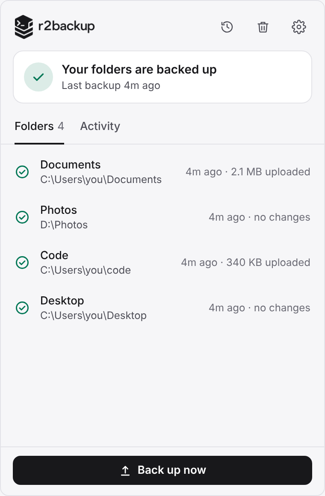

<div align="center">

<picture>
  <source media="(prefers-color-scheme: dark)" srcset="assets/logo-dark.png">
  
</picture>

**Back up your folders to Cloudflare R2 or Drime, and get them back anywhere.**

[](https://github.com/saurabhhbansal/r2backup/releases/latest)
[](https://github.com/saurabhhbansal/r2backup/actions)
[](#install)
[](LICENSE)

[Install](#install) · [Taskbar app](#the-taskbar-app) · [Terminal](#the-terminal) · [How it works](#how-it-works) · [Release notes](https://github.com/saurabhhbansal/r2backup/releases)

<br>

<picture>
  <source media="(prefers-color-scheme: dark)" srcset="assets/panel-dark.png">
  
</picture>

</div>

---

r2backup keeps your folders backed up to cheap object storage. Set it up once,
and it backs up on a schedule, keeps deleted files for 30 days, picks up where
it stopped after a dropped connection, and restores to any computer you sign
in on. On Windows it lives in the taskbar; everywhere, it is one static `r2b`
binary with a full terminal interface.

- **Two places to keep backups.** [Cloudflare R2](https://www.cloudflare.com/developer-platform/products/r2/)
  or [Drime](https://drime.cloud), and optionally a second copy on the other.
- **Plain files, not a format.** The bucket holds your folder as it is, one
  object per file. You can browse and download it without r2backup.
- **Nothing to pay when nothing changed.** A local index decides what to
  upload, so an unchanged folder makes no requests.
- **Any computer.** Sign in with the same email elsewhere and your storage
  keys and backups are already there.
- **No background service.** It runs when the scheduler starts it, then exits.

## Install

**Windows** — PowerShell

```powershell
irm https://github.com/saurabhhbansal/r2backup/releases/latest/download/install.ps1 | iex
```

**macOS / Linux**

```sh
curl -sSL https://github.com/saurabhhbansal/r2backup/releases/latest/download/install.sh | sh
```

Both scripts check the download against the published checksums. On Windows
the installer also adds **r2backup** to the Start menu and offers to start it.
Prefer to do it by hand? Every release has archives for Windows, macOS and
Linux on amd64 and arm64 on the
[releases page](https://github.com/saurabhhbansal/r2backup/releases/latest).

You need somewhere to put the backups — either:

- **Drime** — one API token, from Drime → Settings → Developer.
- **Cloudflare R2** — a bucket and an S3 API token for it. r2backup can sign
  you in to Cloudflare to find your account and buckets (or make one); the
  token itself is made in the dashboard → R2 → Manage API tokens.

## The taskbar app

Windows only. Start **r2backup** from the Start menu, or run `r2bw tray`. An
icon appears next to the clock, and its colour says how the backups are doing:
green when they are fine, blue while one runs, red when a folder needs a look.
A click opens the panel:

- how the last backups went, and a running one's progress and time left
- each folder, with **Back up** and **Open**, and **Back up now** for all
- **Activity**: the recent runs, and what each uploaded, moved or put in trash
- **Backups** (the clock icon): every backup in your storage, from every
  computer, to restore from or delete
- **Deleted files** (the bin icon): what is in the trash and until when
- **Settings**: your account, automatic backups and how often, Start with
  Windows, adding a folder, updates

Everything is done in the panel. Nothing sends you to a terminal.

**Signing in.** The panel asks for an email address first and sends a 6-digit
code to it — there is no password. Your account is under **Settings →
Account**: choose where backups go (Drime or Cloudflare R2) and a second copy
(none, Drime or R2); once a key is entered it shows as saved. The keys are kept
with your account, so another computer signed in with the same email gets them
without typing them again.

**Your computers.** The Account screen lists every computer signed in to your
account. The pencil next to this one renames it — new folders are filed under
the new name, and folders already backed up keep where they are.

**Deleting.** Deleting a backup — a folder's, or one another computer made —
asks first, and with a second copy it asks whether to delete it from both
places or only from where backups go.

The panel starts the same `r2b` commands the terminal does, so a backup started
from it is exactly the one the scheduler runs. It uses WebView2, which comes
with Windows 11; on Windows 10, install the
[WebView2 Runtime](https://go.microsoft.com/fwlink/p/?LinkId=2124703) — if it
is missing, the app says so instead of quietly not starting.

## The terminal

On any platform:

```sh
r2b setup              # pick Drime or R2, sign in and store your keys
r2b add ~/Documents    # choose what goes in, then it backs up and schedules itself
r2b                    # open the dashboard
```

`add` shows the folder as a tree with everything ticked. Untick what you do
not want, press enter, and it takes care of the rest — including offering to
run every 30 minutes from then on.

<div align="center">
<br>

<br><br>
</div>

`r2b` on its own opens the dashboard, and everything is there — signing in,
adding a folder, restoring, scheduling. Every command and every flag has a
key, and that is a test rather than a claim: the build fails if one is added
without.

Five modes, on <kbd>1</kbd>–<kbd>5</kbd> or <kbd>tab</kbd>:

| mode | |
|---|---|
| **Folders** | what is backed up, and what each run did |
| **Schedule** | whether backups run by themselves, how often, and when next |
| **Cost** | what is stored, operations used, and what the month is coming to |
| **Trash** | what is recoverable, and until when |
| **Account** | your keys, signing in, and your other computers |

| key | |
|---|---|
| <kbd>a</kbd> | add a folder — browse to it, then tick what goes in |
| <kbd>b</kbd> <kbd>B</kbd> | back up this folder · back up all of them |
| <kbd>e</kbd> <kbd>r</kbd> | change what is included · restore |
| <kbd>f</kbd> <kbd>c</kbd> | what is stored, with sizes · every backup in the bucket |
| <kbd>n</kbd> <kbd>m</kbd> | rename · point at a folder that moved |
| <kbd>x</kbd> <kbd>X</kbd> | stop backing a folder up · stop and delete the stored copy |
| <kbd>?</kbd> | every key |

### Commands

Every command also works on its own, which is what the scheduler and your
scripts use.

| command | |
|---|---|
| `r2b setup` | Get this computer ready. `--keys` to re-enter your keys |
| `r2b add <folder>` | Choose what to include, then back it up |
| `r2b edit <set>` | Change what a folder includes |
| `r2b backup [set]` | Back up now — all folders, or one |
| `r2b restore <set>` | Bring a folder back. `--to`, `--only`, `--verify`, `--deleted`, `--machine` |
| `r2b status` | What ran, when, and what is next. `--watch` follows a run |
| `r2b ls [set]` | What is stored |
| `r2b trash ls [set]` | What is recoverable, and until when |
| `r2b schedule` | Automatic runs. `--every`, `--remove`, `--repair` |
| `r2b rename` · `r2b relink` | Rename a set · point one at a folder that moved |
| `r2b remove <set>` | Stop backing a folder up. `--purge` deletes the copy too |
| `r2b budget` | What this is costing. `set <amount>`, `off`, `continue` |
| `r2b account` | The computers signed in. `devices`, `logout` |
| `r2b mirror` | Copy backups to a second place, Drime ↔ R2. `setup`, `auto on`, `--reverse`, `--dry-run` |
| `r2b update` | Update to the latest release |

## How it works

**Mirrors, not snapshots.** The bucket holds your folder as it is now, one
object per file, browsable in the R2 dashboard or the Drime web app.

**Keeps deleted files for 30 days.** Anything deleted or overwritten goes to
trash first, and `restore --deleted` (or **Deleted files** in the panel)
brings it back.

**Costs nothing when nothing changed.** A local index decides what to upload,
so an unchanged folder makes no requests at all — except one listing a day,
to expire trash that has aged out.

**Picks up where it stopped.** A file interrupted by a dropped connection or a
shutdown keeps the parts already uploaded and carries on from there — at the
next run, or a minute after you next sign in. An interruption costs at most
16 MB of re-uploading, whatever the file's size.

**Tells you the truth about time.** If it says two hours, it means two hours.

**Restores anywhere.** Sign in on another computer with the same email and it
picks up your keys and finds what is in your storage, with no local record of
it.

### Layout in storage

```
machines/<computer>/<folder>/current/…   the folder as it is now
machines/<computer>/<folder>/trash/…     deleted files, kept 30 days
```

On R2 that is the top of the bucket; on Drime it sits inside a folder called
**r2backup**. A folder's location is fixed when it is first added. Renaming the folder, or
the computer, changes what it is called on this computer, not where it is
stored — so another computer restoring it uses the name it had when it was
added. `r2b rename` prints that original name whenever it differs, so you
don't have to remember it.

## More than one computer

Sign in with the same email on each. In the taskbar app that is all there is
to it. In the terminal, run `r2b setup` on each: the first machine stores your
R2 keys, encrypted under a password you choose, and every one after that finds
them and asks for that password.

```sh
r2b setup
r2b restore Documents --to ~/Documents
```

Leave the email blank at the prompt to skip the account and keep everything on
one machine.

## Drime

Drime has no S3 interface, so r2backup speaks its own API. You get the same
tool — scheduling, trash, resuming, restore anywhere — with the backups laid
out as ordinary folders under **r2backup** in your Drime, which you can browse
and download from the Drime web app without r2backup at all.

Drime keeps no modification dates or permissions on files, so each folder has
a small `.r2backup-manifest.json.gz` beside `current/` that holds them.
Restores put dates back from it; a file downloaded straight from the web app
gets Drime's upload date instead. Large files go up in 16 MB parts and pick up
where they stopped, as on R2.

Drime does not publish its API. r2backup uses the endpoints its web app uses,
as documented by [rclone's Drime backend](https://rclone.org/drime/), so a
change on Drime's side could break it until a release catches up.

### Compared with rclone

rclone can copy to Drime too. Timed side by side on the same data and
connection ([details](docs/benchmark-rclone-drime.md)):

| | r2backup | rclone |
|---|---:|---:|
| First upload, 1,000 small files | **116 s** | 759 s (397 s with `--transfers 16`) |
| First upload, 2 × 128 MB | 45 s | 46 s (38 s with `--transfers 16`) |
| Re-run, nothing changed | **1.1 s** | 20.5 s |
| Re-run after a day's edits and a folder rename | **47 s** | 91 s |
| Files edited without changing size, backed up | **5 of 5** | 0 of 5 |

Large files are a tie — both are limited by Drime's bandwidth. The last row
is the one to read twice: Drime keeps no file dates, so a default `rclone
sync` decides by size alone and skips an edit that keeps the size the same.

## A second copy

The second copy keeps what is stored in one place in a second — Drime to R2 or
R2 to Drime — so your files are with two companies, not one. In the panel,
choose it under **Settings → Account → Second copy**; in the terminal:

```sh
r2b mirror setup       # choose the second place; offers to mirror after every backup
r2b mirror             # copy now: only what changed since last time
r2b mirror --dry-run   # say what would be copied, change nothing
r2b mirror --reverse   # copy back from the mirror, e.g. after losing the main one
```

It copies store to store, not from your folder, so any computer set up for
both can run it, and `--everything` covers every computer's backups. Files
removed from the backup are removed from the second copy too — but if the
source ever lists nothing at all, the copy keeps its files: that is far more
often a wrong account or an outage than a real deletion. With automatic
copying on, every backup (scheduled ones included) is copied once it finishes.

## Cost

R2 bills for storage and operations; most people backing up a documents folder
stay inside Cloudflare's free tier. The **Cost** mode, `r2b budget`, and
**Usage and cost** in the panel show what is stored, how many operations have
been used and what the month is coming to. These are estimates worked out from
what r2backup itself did, at Cloudflare's published rates.

You can set a monthly limit (`r2b budget set 5`). When the estimate reaches
it, backups pause until you carry on or the month ends. Restores are never
paused. There is no limit unless you set one.

## Privacy and security

- **Your files go straight from your computer to your storage.** They never
  pass through any server of ours.
- **The account** is a small Cloudflare Worker ([`worker/`](worker)). It
  knows your email, the names of your computers, and your storage keys.
- **Keys saved from the taskbar app** are encrypted by the account server
  (AES-256-GCM), which means that server could read them. Keys stored by
  `r2b setup` are encrypted on your computer under a password you choose
  before they leave it, and the server keeps a blob it cannot read.
  Forgetting that password is not a data-loss event — it guards the stored
  keys, not your files.
- **On disk**, the R2 secret is encrypted with DPAPI on Windows; on macOS and
  Linux the file is `0600` in a `0700` directory, and `setup` tells you which
  of the two you got.

Found a security problem? See [SECURITY.md](SECURITY.md).

## Where things are kept

| | |
|---|---|
| Windows | `%LOCALAPPDATA%\r2backup` |
| macOS | `~/Library/Application Support/r2backup` |
| Linux | `$XDG_DATA_HOME/r2backup`, else `~/.local/share/r2backup` |

| environment variable | |
|---|---|
| `R2BACKUP_DATA_DIR` | keep everything somewhere else |
| `R2BACKUP_MACHINE` | this computer's name, overriding the hostname and the panel |
| `R2BACKUP_NO_UPDATE_CHECK` | never ask about new releases |

## Building from source

Go 1.25 or later. No cgo, so every target cross-compiles from anywhere.

```sh
go build ./cmd/r2b                                         # the program
GOOS=windows go build -ldflags -H=windowsgui ./cmd/r2bw    # the Windows launcher and taskbar app
go test ./...                                              # the tests
```

The account Worker has its own tests: `cd worker && npm ci && npm test`.

Releases are built by [GoReleaser](.goreleaser.yaml) when a `v*` tag is
pushed; each one's notes are in [`.github/release-notes`](.github/release-notes).

## Licence

MIT — see [LICENSE](LICENSE).
