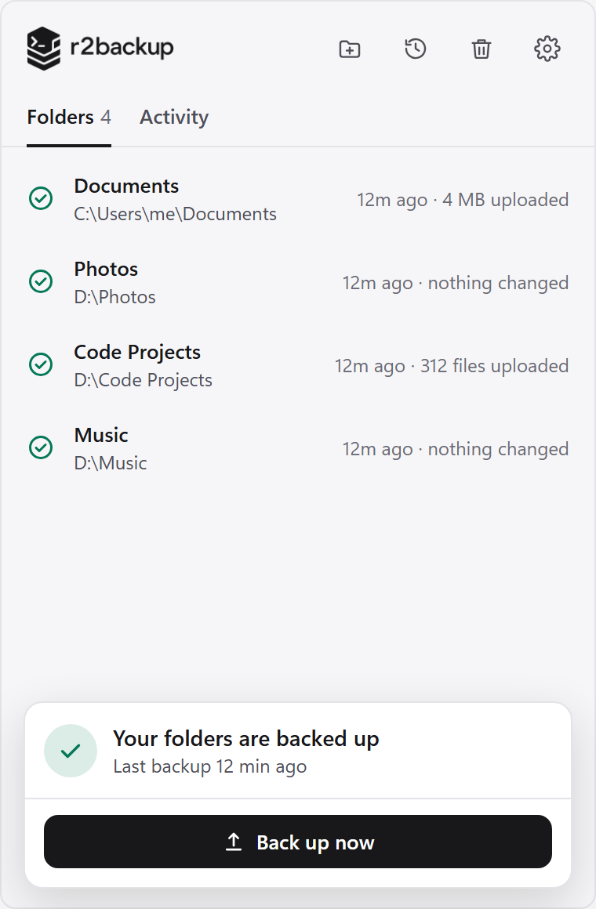
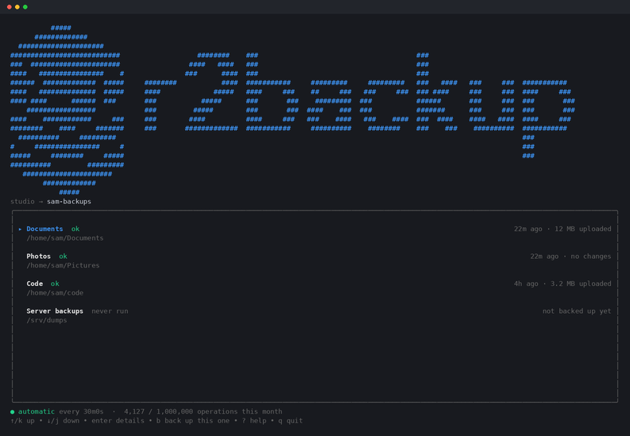

<div align="center">

<picture>
  <source media="(prefers-color-scheme: dark)" srcset="assets/logo-dark.png">
  
</picture>

**Back up your folders to Drime, with a secondary backup on S3 storage.**

[](https://github.com/saurabhhbansal/r2backup/releases/latest)
[](https://github.com/saurabhhbansal/r2backup/actions)
[](#install)
[](LICENSE)

[Install](#install) · [Quick start](#quick-start) · [How it compares](#how-it-compares) · [Features](#features) · [Release notes](https://github.com/saurabhhbansal/r2backup/releases)

<br>

<picture>
  <source media="(prefers-color-scheme: dark)" srcset="assets/panel-dark.png">
  
</picture>

</div>

---

r2backup backs up your folders to [Drime](https://drime.cloud) and keeps a
Secondary backup on S3 storage — Cloudflare R2, Backblaze B2, Amazon S3 or any
other S3 storage. Set it up once and it runs on a schedule. On Windows it
lives in the taskbar. On macOS and Linux (and Windows too) it is one `r2b`
program with a full terminal app.

## Why r2backup

- **Two copies with two companies, set up in one place.** Your **Primary
  backup** goes to Drime, and a **Secondary backup** is copied to S3 storage
  after every run. That is a 3-2-1 setup without writing scripts.
- **Already use the Drime app?** Choose **Secondary backup only** and
  r2backup copies your Drime folders to S3 storage. With Ultra fast mode, the
  copy runs cloud to cloud through a Worker in your own Cloudflare account, so
  nothing goes through your PC.
- **Fast with many small files.** Uploads to Drime run in parallel and adjust
  to what the server allows. An unchanged folder is checked against a local
  index, so a re-run takes about a second and makes almost no requests.
- **Catches edits that keep the size the same.** Drime keeps no file dates,
  so a tool that compares by size skips a file edited in place. r2backup
  compares against its own index and backs it up.
- **No terminal needed, unless you want one.** A taskbar panel on Windows,
  and the same features in `r2b` and its terminal app on every platform.

## Install

**Windows** — PowerShell

```powershell
irm https://github.com/saurabhhbansal/r2backup/releases/latest/download/install.ps1 | iex
```

**macOS / Linux**

```sh
curl -sSL https://github.com/saurabhhbansal/r2backup/releases/latest/download/install.sh | sh
```

Both scripts check the download against the published checksums. On Windows
the installer also adds **r2backup** to the Start menu and offers to start it.
To install by hand, download an archive for Windows, macOS or Linux (amd64 or
arm64) from the [releases page](https://github.com/saurabhhbansal/r2backup/releases/latest).

The taskbar app uses WebView2, which comes with Windows 11. On Windows 10,
install the [WebView2 Runtime](https://go.microsoft.com/fwlink/p/?LinkId=2124703)
first; if it is missing, the app tells you.

## Quick start

You need a Drime API token (Drime → Settings → Developer) and, for the
Secondary backup, a bucket and key on your S3 storage.

**In the taskbar panel (Windows)**

1. Start **r2backup** from the Start menu and click the icon next to the clock.
2. Choose **Use without an account** (or sign in), then what you use r2backup
   for, and enter your Drime token and S3 storage.
3. Click **Add folder**, pick a folder, and it backs up. New setups back up
   automatically and start with Windows.

**In the terminal**

```sh
r2b setup              # without an account or with one, then Primary and Secondary backup
r2b add ~/Documents    # tick what goes in; it backs up and offers a schedule
r2b                    # open the terminal app
```

## Two ways to use it

| | **Primary and secondary backup** | **Secondary backup only** |
|---|---|---|
| For | People who want r2backup to do the backing up | People who already back up to Drime with Drime's app or another tool |
| Primary backup | Your folders → Drime | Done by the other app |
| Secondary backup | Drime → S3 storage, after every run | Chosen Drime folders → S3 storage |
| Set up | `r2b setup purpose both` | `r2b setup purpose copy`, then `r2b mirror drime add <folder>` |

Both are chosen in the panel under **What are you using r2backup for?**. The
Secondary backup can be Cloudflare R2, Backblaze B2, Amazon S3 or any other
S3 storage. You can leave it for later (`r2b setup --second none`) and add it
with `r2b mirror setup`.

Older setups that back up straight to S3 storage, without Drime, keep working;
this is no longer offered for new setups.

## How it compares

**rclone** has a native Drime backend and can do almost anything with
storage. It is a command-line tool: you write the commands,
schedule them yourself, and add a second destination as a second job. On
Drime, a default `rclone sync` compares files by size only, so it skips
edits that keep the size the same (`--update` helps in most cases). rclone
keeps no deleted files unless you set `--backup-dir`.

**Drime's own app** can back up folders to Drime. If you use it, keep it:
**Secondary backup only** copies those backups to S3 storage, so you have a
copy with a second company.

**restic and Kopia** make encrypted, deduplicated snapshots with history.
Your storage holds packed data that only the tool can read. r2backup keeps
your folder as plain files you can browse and download from the Drime web
app or your S3 storage's dashboard, plus deleted and overwritten files for
30 days (or as long as you choose). It does not keep point-in-time
snapshots, and it does not encrypt your files on top of what your storage
does.

### Measured against rclone on Drime

Measured in November 2026 with r2backup 1.5.0 and rclone 1.75.0
(`--transfers 16`, its fastest setting on Drime), on the same data and
connection ([details and caveats](docs/benchmark-rclone-drime.md)):

| | r2backup | rclone |
|---|---:|---:|
| First upload, 10,000 files of 1–16 KB | **5 min** | 2 h 2 min |
| First upload, 1,000 files of 100 KB–5 MB (1.2 GB) | **1.5–2 min** | 8–12 min |
| First upload, 200 photos (1.1 GB) | **92 s** | 113 s |
| First upload, 2 × 512 MB | 103 s | **93 s** |
| Re-run, nothing changed | **about 1 s** | 16–41 s |
| Re-run after 40 edits, adds and deletes and a folder rename | **16 s** | 24 s |
| Files edited without changing size, backed up | **20 of 20** | 0 of 20 |

rclone is a bit faster with large files: both are limited by Drime's
bandwidth. The more files, the further ahead r2backup is. The benchmark page
has the method and what it does not cover.

## Features

### The taskbar app

Windows only. Start **r2backup** from the Start menu, or run `r2bw tray`. The
icon's colour says how backups are doing: green when they are fine, blue while
one runs, red when a folder needs a look. A click opens the panel:

- the status, progress and time left, with **Back up now** and **Pause**
- each folder, with **Back up**, **Open** and its own **Secondary backup** switch
- **Add folder** and **Restore**
- **Activity**: recent runs and what each one uploaded, moved or put in
  trash, with **Clear**
- **Backups**: every backup in your storage, from every computer
- **Deleted files**: what is in the trash, and until when
- **Settings**: account and storage, what you use r2backup for, Drime
  workspace and folder, Drime folders, how often to back up, Start with
  Windows, **Import/Export** of keys, **Check for updates**

The panel runs the same `r2b` commands the terminal does, so a backup started
from it is the same one the schedule runs.

### The terminal

`r2b` on its own opens the terminal app, with four modes on
<kbd>1</kbd>–<kbd>4</kbd> or <kbd>tab</kbd>: **Folders**, **Schedule**,
**Trash** and **Account**. Press <kbd>?</kbd> for every key. Every command and
flag has a key in the app; a test fails the build if one is added without.

<div align="center">
<br>

<br><br>
</div>

Every command also works on its own, which is what the schedule and your
scripts use:

| command | |
|---|---|
| `r2b setup` | Get this computer ready. `purpose both\|copy`, `--keys`, `--provider`, `--second <kind>\|none` |
| `r2b add <folder>` | Choose what to include, then back it up. `--name`, `--retention`, `--all` |
| `r2b edit <set>` | Change what a folder includes. `--exclude`, `--include`, `--retention <days>` |
| `r2b backup [set]` | Back up now, all folders or one |
| `r2b pause` · `r2b resume` | Pause the running backup, or carry on |
| `r2b status` | What ran, when, and what is next. `--watch` follows a run |
| `r2b restore <set>` | Bring a folder back. `--to`, `--only`, `--verify`, `--deleted`, `--machine`, `--overwrite` |
| `r2b ls [set] [folder]` | What is stored. `--machine` for another computer's |
| `r2b activity [number]` | Recent backups, and what one did. `clear` |
| `r2b backups` | Every backup in your storage, by computer. `delete <name>` |
| `r2b trash` | Deleted files. `ls`, `recover`, `rm`, `empty` |
| `r2b schedule` | Automatic backups. `every <time>`, `daily <HH:MM>`, `off` |
| `r2b drime` | `workspaces`, `folders [path]`, `use <folder>` |
| `r2b mirror` | The Secondary backup. `setup`, `off`, `folder <set> on\|off`, `--dry-run`, `--reverse`, `--everything` |
| `r2b mirror drime` | Drime folders to copy to S3 storage. `add`, `ls`, `run`, `rm` |
| `r2b mirror ultra` | Ultra fast mode. `on`, `off` |
| `r2b pack on\|off` | Pack small files on S3 storage. `--second-copy` for the Secondary backup |
| `r2b account` | Account, storage and computers. `login`, `reset-pin`, `save-keys`, `rename`, `devices`, `logout` |
| `r2b keys` | Move storage keys without an account. `export <file>`, `import <file>` |
| `r2b rename` · `r2b relink` | Rename a folder's set · point it at a folder that moved |
| `r2b remove <set>` | Stop backing a folder up. `--purge` also deletes its backup |
| `r2b update` | Update to the latest release. `--check` only looks |

Anything that deletes asks first, as the panel does. For scripts, `--yes`
answers yes and `--no` takes the safe path; with neither and no terminal, a
command that would ask stops instead.

<details>
<summary>Panel to terminal, side by side</summary>

| in the panel | in the terminal |
|---|---|
| What are you using r2backup for? | `r2b setup purpose both\|copy` |
| Use without an account · sign in · Forgot PIN? | `r2b setup` · `r2b account login` · `r2b account reset-pin` |
| Import/Export | `r2b keys import <file>` · `r2b keys export <file>` |
| Primary backup → Change… | `r2b setup --keys` (or `--provider drime\|r2\|b2\|s3\|s3-custom`) |
| Drime workspace and folder | `r2b drime workspaces` · `r2b drime folders` · `r2b drime use <folder>` |
| Secondary backup · Stop | `r2b mirror setup` · `r2b mirror off` |
| A folder's Secondary backup switch | `r2b mirror folder <set> on\|off [--delete]` |
| Drime folders | `r2b mirror drime add\|ls\|run\|rm` |
| Ultra fast mode | `r2b mirror ultra on\|off` |
| Pack small files | `r2b pack on\|off` |
| Rename this computer · the computers | `r2b account rename <name>` · `r2b account devices` |
| Add folder · what it includes · keep deleted files | `r2b add <folder>` · `r2b edit <set>` · `r2b edit <set> --retention <days>` |
| Back up automatically, and how often | `r2b schedule every 2h` · `r2b schedule daily 21:30` · `r2b schedule off` |
| Back up now · Pause · Resume | `r2b backup [set]` · `r2b pause` · `r2b resume` |
| Backups · delete one | `r2b backups` · `r2b backups delete <name>` |
| Activity · a run's details · Clear | `r2b activity` · `r2b activity <number>` · `r2b activity clear` |
| Restore | `r2b restore <set>` (`--machine` for another computer's) |
| Deleted files | `r2b trash ls\|recover\|rm\|empty` |
| Check for updates | `r2b update --check` · `r2b update` |

In the terminal app: <kbd>a</kbd> add a folder, <kbd>b</kbd>/<kbd>B</kbd> back
up one or all, <kbd>e</kbd> change what is included, <kbd>r</kbd> restore,
<kbd>f</kbd> what is stored, <kbd>c</kbd> another computer's backups,
<kbd>n</kbd> rename, <kbd>m</kbd> folder moved, <kbd>x</kbd>/<kbd>X</kbd> stop
backing up (and delete the stored copy), <kbd>p</kbd> pause or resume on the
progress screen.

</details>

### Pause, resume and outages

Pause a running backup from the panel, with `r2b pause`, or with <kbd>p</kbd>
in the terminal app; files already uploading finish first. `r2b resume`
carries on. A pause lasts for that run only.

Finished files are recorded as the backup goes, so a backup that is stopped,
crashes or loses power carries on from there next time. A large file keeps
the 16 MB parts already uploaded. If the internet drops, the backup waits for
it to come back, for up to two hours, then carries on.

### Scheduling

`r2b schedule every 45m` (from 5 minutes to 24 hours) or, on Windows,
`r2b schedule daily 21:30`. It registers with Task Scheduler on Windows, a
systemd user timer (or cron) on Linux, or launchd on macOS. Nothing of r2backup stays
running between runs.

### Deleted files

Anything deleted or overwritten goes to trash first and is kept for 30 days
by default, or 7 to 365 days as you choose (`r2b edit <set> --retention <days>`).
**Deleted files** in the panel, or `r2b trash`, brings it back.

### Restore anywhere

Restore a whole folder, part of it (`--only "docs/**"`), to another place
(`--to`), or from another computer's backup (`--machine`). r2backup reads what
is in your storage, so a new computer needs no local record.

### More than one computer

- **Without an account.** The keys stay on this computer. Export them to a
  file encrypted under a passphrase you choose, and import it on the other
  one.
- **With an account** (hosted, for personal use). Sign in with your email,
  the six-digit code sent to it, and your PIN. The first computer saves its
  keys to the account; every one after that picks them up.

**Forgot PIN?** sends a new code and sets a new PIN. That deletes the keys
the account kept and signs your other computers out, but leaves your backups
alone.

### Ultra fast mode (experimental)

Copying Drime to S3 storage normally downloads each file to your PC and
uploads it again. With Ultra fast mode, a small Worker in **your own**
Cloudflare account copies each file from Drime straight to your S3 storage.
It applies to the Secondary backup and to Drime folders, and is off until you
turn it on (`r2b mirror ultra on`, or the switch in the panel).

<details>
<summary>How Ultra fast mode works</summary>

- The Cloudflare API token needs one permission: *Account → Workers Scripts →
  Edit*. r2backup uses it to upload the Worker (its code is in
  [`relay/`](relay/)), turn on its workers.dev address and give it a password
  only this computer knows. The token and the password stay on this computer.
- The Worker holds no storage keys. For each file r2backup gives it a
  temporary Drime download link and a presigned upload link, and it pipes the
  bytes between them; big files go in 64 MB parts, several at once.
- It runs on Cloudflare's free Workers plan: 100,000 requests a day, one per
  file and one per 64 MB part. Backblaze B2 and Amazon S3 users need a free
  Cloudflare account for it too.
- With packing on, files of 4 MB or less still come to your PC to be packed;
  only bigger files go cloud to cloud.
- If the Worker fails, or the day's allowance runs out, the rest is copied
  through your PC and the report says so.
- `r2b mirror ultra off` deletes the Worker and forgets the token.

</details>

Adding a backup folder that is inside Drime's synced folder on your PC warns
you: backing it up from there would download it from Drime first. Copying it
as a Drime folder instead skips that.

## How it works

**Plain files, not snapshots.** Your storage holds each folder as it is now,
one file per file, plus a trash folder. You can browse it in the Drime web
app or your S3 storage's dashboard without r2backup.

**A local index decides what to upload,** from each file's size and
modification time. An unchanged folder makes almost no requests; a renamed
folder is moved in storage, not uploaded again.

**The Secondary backup copies storage to storage,** not from your folder, so
any computer set up for both can run it. Only what changed is copied, and
files removed from the Primary backup are removed from the Secondary backup
too. If the source ever lists nothing at all, the copy keeps its files: that
is more often a wrong account or an outage than a real deletion.

<details>
<summary>Layout in storage, Drime details and packing</summary>

```
machines/<computer>/<folder>/current/…   the folder as it is now
machines/<computer>/<folder>/trash/…     deleted files
machines/<computer>/<folder>/.bundles/…  packed small files, when packing is on (S3 storage)
machines/drime-mirror/<name>/current/…   Drime folders copied by Secondary backup only
```

On S3 storage this is the top of the bucket. On Drime it sits inside a folder
called **r2backup** by default, or the workspace and folder you choose with
`r2b drime use`. A folder's location is fixed when it is first added:
renaming it, or the computer, changes its name here, not where it is stored.
`r2b rename` prints the original name whenever it differs.

**Drime.** r2backup uses Drime's [public API](https://docs.drime.cloud). Drime
keeps no modification dates or permissions, so each folder has a small
`.r2backup-manifest.json.gz` beside `current/` that holds them; restores put
dates back from it. Large files go up in 16 MB parts and pick up where they
stopped.

**Packing small files (S3 storage only).** Storage priced by the request
charges the same to upload a 2 KB file as a 2 GB one. With **Pack small files**
on, files under 4 MB go up in 16 MB zip archives, with an index saying where
each one is. A changed file goes into a new archive; moves, renames and
deletes only edit the index; mostly empty archives are repacked. Restores,
trash and the Secondary backup work the same, and an archive downloaded by
hand opens with any unzip tool. Setup suggests it for S3 storage, it can be turned off at
any time, and what was packed stays readable. Drime does not charge by the
request, so the panel does not offer packing for it.

</details>

## Privacy and security

- **Your files go straight from your computer to your storage,** or, with
  Ultra fast mode, through a Worker in your own Cloudflare account. They never
  pass through a server of ours.
- **No account is needed.** Used without one, nothing about you or your keys
  leaves your computer except to your own storage.
- **The account** is a small Cloudflare Worker ([`worker/`](worker)). It knows
  your email, the names of your computers, and a proof of your PIN.
- **Keys saved to the account** are encrypted on your computer
  (XChaCha20-Poly1305) under a key made from your PIN (Argon2id) and a share
  the server hands out only after a correct PIN. The server keeps ciphertext
  it cannot open on its own. Five wrong PINs lock the account for 15 minutes,
  then longer.
- **Exported key files** are encrypted the same way, under a passphrase of at
  least 8 characters.
- **On disk,** storage secrets are encrypted with DPAPI on Windows; on macOS
  and Linux the file is `0600` in a `0700` directory.
- **Your backed-up files are not encrypted by r2backup.** They are as private
  as your Drime and S3 storage accounts.

Found a security problem? See [SECURITY.md](SECURITY.md).

## Where things are kept

| | |
|---|---|
| Windows | `%LOCALAPPDATA%\r2backup` |
| macOS | `~/Library/Application Support/r2backup` |
| Linux | `$XDG_DATA_HOME/r2backup`, else `~/.local/share/r2backup` |

| environment variable | |
|---|---|
| `R2BACKUP_DATA_DIR` | keep everything somewhere else |
| `R2BACKUP_MACHINE` | this computer's name, instead of the hostname |
| `R2BACKUP_NO_UPDATE_CHECK` | never ask about new releases |

## Contributing

Bug reports and pull requests are welcome. See [CONTRIBUTING.md](CONTRIBUTING.md)
for how to build and test, and [docs/architecture.md](docs/architecture.md) for
how the code fits together.

```sh
go build ./cmd/r2b    # the program (Go 1.25 or newer, no cgo)
go build ./cmd/r2bw   # Windows launcher for the taskbar app
go vet ./...
go test ./...         # the tests; the full suite takes several minutes
```

## Licence

MIT — see [LICENSE](LICENSE).
