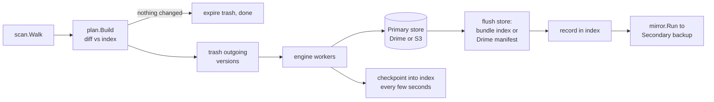

# Architecture

A map of the code for people who want to change it. Module path `github.com/saurabhhbansal/r2backup`; two programs, two small Workers.

## Programs

| Path | What it is |
| --- | --- |
| `cmd/r2b` | The program. Cobra command line, plus a full-screen terminal app when run with no arguments. `r2b tray` runs the Windows taskbar panel. |
| `cmd/r2bw` | Windows only. A launcher that runs the `r2b.exe` beside it with no console window, so Task Scheduler runs do not flash a window. It has no logic of its own. |
| `worker/` | Account service (Cloudflare Worker, TypeScript, D1 database): email sign-in, a PIN, and the encrypted storage keys an account keeps. See `worker/README.md`. |
| `relay/` | Ultra fast mode's Worker (plain JS, embedded in the Go binary by `relay/relay.go`). See `relay/README.md`. |

## Packages (`internal/`)

Command line and interfaces

- `cli`: the command surface, cobra commands and the glue that runs them. `app.go` opens everything under the data directory; `run.go` is `r2b backup`; `mirror*.go` is the Secondary backup; `tray*.go` is the panel's backend.
- `ui`: the full-screen terminal app (Bubble Tea) with its keys, forms and flows.
- `tui`: the folder picker shown when adding a folder.
- `tray`: the Windows taskbar app. `panel.html` is the whole panel UI; `tray_windows.go` hosts it in WebView2; `state.go` builds the panel's data; `backend.go` is the interface `cli` implements.
- `winconsole`: keeps scheduled runs off screen on Windows.

Backup and restore

- `scan`: walks a folder and lists what is there, with portable keys.
- `plan`: compares the scan with the index and produces the complete work list (uploads, moves, deletes) before any byte moves.
- `index`: bbolt cache of what has been uploaded per set, so an unchanged run asks storage nothing.
- `engine`: runs a plan with bounded, adaptive concurrency. One bad file never stops the rest.
- `backup`: one backup, start to finish: scan, plan, trash, transfer, checkpoint, record.
- `bundle`: packs small files into zip archives so S3 request counts stay low.
- `trash`: moves outgoing versions to `trash/<date>/` and expires them after the set's retention.
- `restore`: turns storage back into files, including from trash; `safepath.go` refuses paths that escape the target.
- `mirror`: store-to-store copy used for the Secondary backup.
- `sets`: which folders are backed up and how (`sets.json`).
- `progress`, `runstate`, `pause`, `netwait`: honest ETA; progress and history files a watcher can read; pause markers; holding a run while offline.
- `schedule`: Task Scheduler, systemd, launchd and cron entries.

Storage and accounts

- `remote`: the `Store` interface and the S3 implementation (R2, B2, S3 and compatibles).
- `drime`: the Drime implementation of `remote.Store`, translating keys to Drime's folder tree. `manifest.go` keeps dates and permissions Drime cannot store.
- `ultrafast`, `cfapi`: Ultra fast mode: uploading the relay through the Cloudflare API and copying Drime to S3 through it.
- `account`, `creds`, `oauth`: the cross-device account and vault, protected local credentials, and Cloudflare browser sign-in.
- `config`: data directory, paths and `settings.json`.
- `selfupdate`: `r2b update`, replacing the binary in place.

## A backup run

`backup.Run` in `internal/backup/backup.go` does the work for one set; `internal/cli/run.go` calls it for each set and then runs the Secondary backup.



1. **Scan.** `scan.Walk` lists the folder, applying the set's exclusions. A missing root is an error, never a mass delete (`ErrRootMissing`).
2. **Plan.** `plan.Build` diffs the scan against `index` and returns the full list of uploads, moves and deletes. The totals are fixed before anything uploads, which is why progress is honest. If the plan is empty the run costs nothing beyond trash expiry.
3. **Trash.** Versions about to be overwritten or deleted are moved aside (`trash.Move`) when the set keeps a trash.
4. **Transfer.** `engine` uploads through a `remote.Store`. `netwait` pauses work while offline and `pause` holds new work on request. Progress goes to `progress` and `runstate`.
5. **Checkpoint.** `backup/checkpoint.go` notes finished files in the index as the run goes (every 2 s for S3, every 15 s for stores that hold writes back), so an interrupted run resumes where it stopped.
6. **Flush and record.** `remote.FlushStore` saves the bundle index or the Drime manifest. Only after that succeeds are uploads recorded in the index, so a failed flush means those files go again next time.
7. **Secondary copy.** `autoMirror` in `internal/cli/mirror.go` runs after `r2b backup` (scheduled or not) for sets that changed or have not been checked for a day, unless the set has `NoSecondary`. `mirror.Run` copies store to store (it needs no local folder) and removes what the source no longer has. With Ultra fast mode on, Drime to S3 copies go through the user's relay Worker.

## Panel and `r2b`

`r2b tray` calls `tray.Run` with a `trayBackend` (`internal/cli/tray.go`). The panel is `panel.html` in WebView2; it sends `{cmd, arg}` messages with `chrome.webview.postMessage`, and the Go side answers through the `tray.Backend` interface. `State` is read-only and cheap (every couple of seconds). Anything that changes things either calls shared code in `internal/cli` (`Call`) or starts a child `r2b --no <command>` process (`trayBackend.start`: backup, add folder), so the panel and the terminal run the same code. The panel's data comes from the same sources the terminal reads (sets, run history, the live progress file), so it also sees runs the scheduler started. `TestPanelPreview` serves the panel to a browser for development.

## Where state lives

Data directory: `%LOCALAPPDATA%\r2backup` (Windows), `~/Library/Application Support/r2backup` (macOS), `$XDG_DATA_HOME/r2backup` or `~/.local/share/r2backup` (Linux). `R2BACKUP_DATA_DIR` overrides it (`internal/config/paths.go`).

| File | Holds |
| --- | --- |
| `sets.json` | Folders being backed up and their options |
| `settings.json` | App-wide settings |
| `index.db` | bbolt index of uploaded files |
| `credentials`, `credentials-mirror`, `credentials-source` | Primary, Secondary and source (Drime) credentials, protected where the OS allows |
| `ultrafast` | Ultra fast mode token and relay details |
| `progress.json`, `pause.json`, `history.json` | Live run state, pause marker, finished runs |
| `locks/`, `logs/` | Per-set run locks and run logs |

## Storage layout

Same shape on Drime (real folders under an `r2backup` folder) and on S3 (key prefixes):

```
machines/<computer>/<folder>/current/...        the live copy, your files as they are
machines/<computer>/<folder>/trash/<date>/...   versions moved aside, kept for the retention period
machines/<computer>/<folder>/.bundles/          bundle mode: index.json.gz and packs/<id>.zip
```

On Drime, `.r2backup-manifest.json.gz` in each folder holds file dates and permissions (`internal/drime/manifest.go`). Backups stay browsable and downloadable without r2backup.

## Tests

- Unit tests sit beside the code; `internal/cli` tests use in-memory stores and a fake account service.
- `test/e2e`: whole-program tests against MinIO (`test/minio` builds it); `test/r2`: real R2, opt-in.
- `worker/test` and `relay/test`: vitest; `relay/relay_test.go` keeps the embedded script and its version in step.
- `.github/workflows/ci.yml` and `release.yml` are the source of truth for what runs; see CONTRIBUTING.md.
